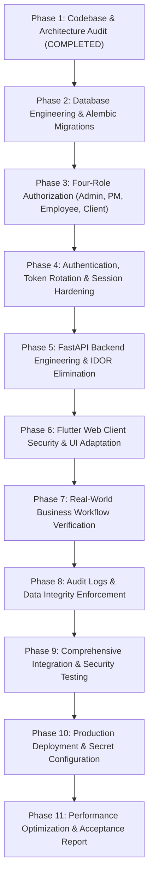

# PRODUCTION_READINESS.md — Enterprise Readiness Assessment & Transformation Plan

**Date**: November 4, 2026  
**Auditor**: Senior Software Architect & Lead Security Engineer  
**System**: TaskForge Enterprise Project Management Application  

---

## 1. Production Readiness Classification

### Current Status: **STAGING READY / ADVANCED DEMO**

> [!WARNING]
> TaskForge is **NOT YET Production Ready**. While the UI is responsive, the Neon cloud database is seeded, and CI/CD pipelines run tests, the system cannot be declared production-ready until resource-level authorization (IDOR protection), four-role access control (specifically client data isolation), and a persistent public backend deployment are completed.

---

## 2. Readiness Scorecard

| Domain | Readiness Score | Production Blocker? | Key Issue |
|:---|:---:|:---:|:---|
| **Database Architecture** | **85%** | **Yes** | Missing foreign key indexes; missing `is_internal` & `is_client_visible` columns. |
| **Authentication & Tokens** | **75%** | **Yes** | No automatic JWT refresh interceptor in Flutter Web; token stored in localStorage. |
| **Authorization (RBAC)** | **50%** | **CRITICAL** | IDOR vulnerabilities on `/tasks/{id}`; PMs can see all projects; Client role missing. |
| **API Layer & Performance** | **80%** | **Yes** | Missing rate limiting; wildcard CORS with credentials; N+1 queries in member lookups. |
| **Flutter Web Client** | **85%** | **No** | Offline mock fallback masks API failures; missing Client role view restrictions. |
| **CI/CD & Cloud Hosting** | **70%** | **CRITICAL** | Backend container is not deployed to a live URL; Firebase rewrites `/api/v1` to HTML. |
| **Automated Testing** | **90%** | **No** | 34 backend tests & 25 Flutter tests passing; need integration tests for 4 roles. |

---

## 3. High-Priority Issues Identified (Phase 1 Audit)

| ID | Issue Description | Severity | Business Impact | Remediated in Phase |
|:---|:---|:---:|:---|:---:|
| **SEC-01** | Insecure Direct Object References (IDOR) on task read, update, and status endpoints | **CRITICAL** | Any user can view or alter tasks across all projects | Phase 3 & 5 |
| **SEC-02** | Unbounded project access for Project Managers (can view/edit non-assigned projects) | **HIGH** | Confidentiality breach between separate projects | Phase 3 |
| **SEC-03** | Missing Client role and absence of client data isolation flags (`is_internal`) | **CRITICAL** | Clients can view internal staff comments and private tasks | Phase 2 & 3 |
| **SEC-04** | Permissive CORS configuration with wildcard `*` and credentials enabled | **HIGH** | Potential cross-origin request forgery via malicious sites | Phase 5 |
| **DB-01** | Unindexed foreign keys on `project_members.user_id`, `tasks.creator_id`, `projects.owner_id` | **HIGH** | Sequential scans degrade performance as database grows | Phase 2 |
| **DB-02** | Unversioned database schema (missing `alembic_version` in Neon PostgreSQL) | **MEDIUM** | Future automated migrations will conflict or fail | Phase 2 |
| **API-01** | Lack of automatic token refresh interceptor in Flutter Web `ApiClient` | **HIGH** | Users get abruptly logged out after access token expiry | Phase 4 & 6 |
| **DEP-01** | Backend not deployed to live public endpoint (Firebase rewrites `/api/v1` to `index.html`) | **CRITICAL** | Live web app falls back to temporary in-memory state | Phase 10 |

---

## 4. Phase-by-Phase Transformation Plan

### Detailed Phase Milestones

1. **Phase 2 — Database Engineering**:
   - Add `employee` and `client` to `UserRole`.
   - Add `is_internal BOOLEAN NOT NULL DEFAULT FALSE` to `task_comments`.
   - Add `is_client_visible BOOLEAN NOT NULL DEFAULT TRUE` to `tasks`.
   - Add `client_id` to `projects`.
   - Add missing B-Tree indexes on `project_members(user_id)`, `tasks(creator_id)`, `projects(owner_id)`, and composite indexes `(project_id, status)`.
   - Initialize Alembic tracking table `alembic_version` in Neon DB.

2. **Phase 3 — Four-Role Authorization System**:
   - Centralize permission logic in `backend/app/core/permissions.py`.
   - Restrict Project Managers to projects they own or are assigned to.
   - Restrict Employees to assigned projects and tasks.
   - Restrict Clients to authorized client projects and client-visible tasks; filter out internal comments.

3. **Phase 4 — Authentication & Session Security**:
   - Implement automatic token refresh in `frontend/lib/services/api_client.dart`.
   - Add refresh token rotation in `backend/app/api/v1/endpoints/auth.py`.
   - Enforce rate-limiting on `/auth/login` to thwart brute-force attacks.

4. **Phase 5 — FastAPI Backend Hardening**:
   - Eliminate all task and comment IDOR vulnerabilities.
   - Enforce atomic transaction boundaries on project and member creation.
   - Fix CORS by removing `"*"` and whitelisting exact production domains.

5. **Phase 6 — Flutter Web Engineering**:
   - Update `UserRole` enum to support Admin, Project Manager, Employee, Client.
   - Restrict UI navigation and action buttons based on user role.
   - Provide clear online persistence status in the UI.

6. **Phase 7 to 9 — Workflow & Automated Testing**:
   - Test Workflows A (Admin), B (PM), C (Employee), and D (Client).
   - Write automated pytest integration tests for client data isolation and permission denial.
   - Run full Flutter unit and widget test suites.

7. **Phase 10 & 11 — Operations, Deployment & Performance**:
   - Set `API_BASE_URL` pointing to the public backend endpoint.
   - Verify zero N+1 queries.
   - Generate Final Production Readiness Certification.

---

## 5. Required Manual Actions by Workspace Owner

To achieve full 24/7 cloud persistence on the live web URL:
1. **Host the Backend Container**:
   - Deploy `backend` to Google Cloud Run (providing `GCP_SA_KEY` in GitHub Secrets) OR to a web service like Render/Railway.
2. **Configure GitHub Repository Secrets**:
   - In `https://github.com/Maniananthgit/TaskForge/settings/secrets/actions`:
     - `API_BASE_URL`: Public HTTPS backend URL (e.g. `https://taskforge-api.onrender.com/api/v1` or Cloud Run URL).
     - `DATABASE_URL`: Your Neon PostgreSQL connection string.

