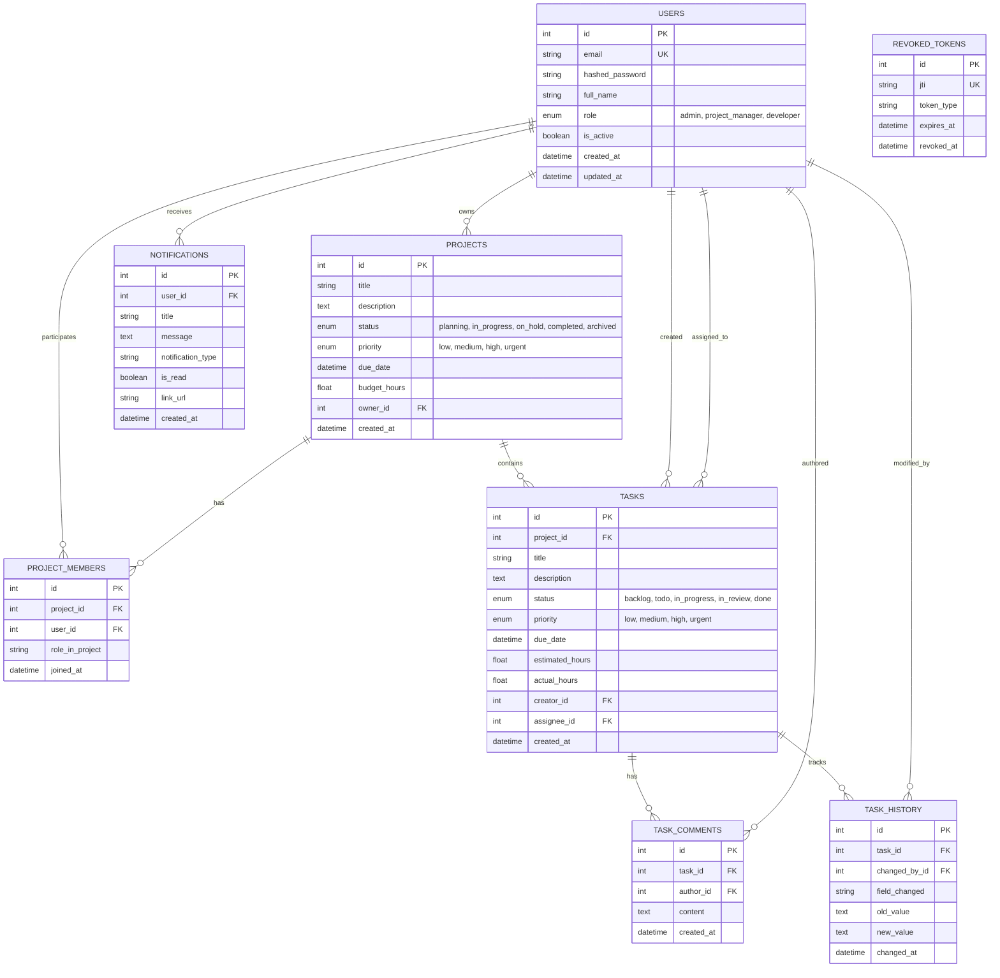

# TaskForge — Enterprise Project Management System

[](https://github.com/Maniananthgit/TaskForge/actions)
[](https://fastapi.tiangolo.com)
[](https://flutter.dev)
[](https://www.postgresql.org)
[](https://www.docker.com)
[](https://opensource.org/licenses/MIT)

**TaskForge** is an enterprise-grade, production-engineered project management and collaborative task orchestration system. Engineered using a modular **FastAPI** backend and an **MVVM Flutter** client, TaskForge delivers sub-millisecond REST performance, role-based access control (RBAC), real-time audit change histories, background workers with Celery & Redis, and a sleek modern dark/light aesthetic.

---

## 📑 Table of Contents
1. [System Architecture](#system-architecture)
2. [Database ER Diagram](#database-er-diagram)
3. [Technology Stack](#technology-stack)
4. [Key Features](#key-features)
5. [Project Structure](#project-structure)
6. [API Documentation](#api-documentation)
7. [Local Setup Instructions](#local-setup-instructions)
8. [Docker & Container Orchestration](#docker--container-orchestration)
9. [Automated Testing](#automated-testing)
10. [Cloud & AWS Deployment](#cloud--aws-deployment)

---

## 🏛 System Architecture

TaskForge follows a decoupled, reactive enterprise architecture. The Flutter client implements the **Model-View-ViewModel (MVVM)** pattern with Provider and GoRouter, while the FastAPI server adopts a multi-tier **Modular / Repository-Service** pattern.

```mermaid
graph TD
    subgraph Client["Flutter Client (Web / Desktop / Mobile)"]
        UI[Views & Widgets]
        VM[ViewModels (Provider State)]
        REPO_F[Data Repositories]
        SEC[Secure Token Storage]
        API_C[API Client & Interceptors]
        UI --> VM
        VM --> REPO_F
        REPO_F --> API_C
        API_C <--> SEC
    end

    subgraph Backend["FastAPI Backend (Python 3.11)"]
        ROUTER[API Routers v1]
        RBAC[RBAC & JWT Security Guard]
        SERVICES[Business Logic Services]
        REPO_B[SQLAlchemy Repositories]
        ROUTER --> RBAC
        RBAC --> SERVICES
        SERVICES --> REPO_B
    end

    subgraph Storage["Data & Cache Tier"]
        PG[(PostgreSQL 16 Database)]
        REDIS[(Redis 7 Cache & Broker)]
        CELERY[Celery Background Workers]
    end

    API_C -- "REST (JSON / Bearer JWT)" --> ROUTER
    REPO_B --> PG
    SERVICES --> REDIS
    SERVICES --> CELERY
    CELERY --> REDIS
    CELERY --> PG
```

---

## 🗄 Database ER Diagram

Relational schema designed with **PostgreSQL**, indexed for high query volume, audit trails, and data consistency:



---

## 🛠 Technology Stack

### Frontend
- **Framework**: Flutter (Channel Stable 3.35.3) & Dart
- **Architecture**: MVVM (Model-View-ViewModel)
- **State Management**: Provider (`ChangeNotifierProvider`, `MultiProvider`)
- **Navigation & Routing**: GoRouter (Guarded route redirection, path parameters)
- **Security & Storage**: `flutter_secure_storage` + `shared_preferences`
- **Charts & Metrics**: `fl_chart`
- **Typography & UI**: Google Fonts Inter, Custom Design Tokens, Adaptive Navigation Rail

### Backend
- **Framework**: FastAPI (Python 3.11)
- **Data Validation & Schemas**: Pydantic v2 & `pydantic-settings`
- **ORM & DB Abstraction**: SQLAlchemy 2.0 (Repository Pattern)
- **Migrations**: Alembic
- **Asynchronous Task Queue**: Celery 5.4 + Redis 7
- **Password Security**: Direct `bcrypt` with salt hashing
- **Token Cryptography**: `python-jose` (JWT) + RSA-OAEP-256 asymmetric encryption

### Infrastructure & DevOps
- **Database**: PostgreSQL 16
- **Cache/Broker**: Redis 7
- **Containerization**: Docker Multi-stage Builds, Docker Compose
- **CI/CD**: GitHub Actions
- **Cloud Readiness**: AWS ECS Fargate, RDS PostgreSQL, ElastiCache Redis, Terraform IaC

---

## 🚀 Key Features

### 1. Role-Based Access Control (RBAC)
- **Admin**: Full workspace access, user role elevation, project deletion, system-wide metrics.
- **Project Manager**: Project creation, member assignment, milestone setting, task orchestration.
- **Developer**: Assigned project view, task status progression, threaded discussion, personal workload tracking.

### 2. Project Portfolio Management
- Multi-project management with completion % tracking.
- Budget hours tracking against actual recorded hours.
- Member assignment with designated roles (`Lead`, `Member`, `Observer`).
- Search, filter by status & priority, and pagination.

### 3. Task Lifecycle & Audit History
- Status workflow: `Backlog` ➔ `To Do` ➔ `In Progress` ➔ `In Review` ➔ `Done`.
- Automated change auditing: every status, priority, or assignee modification generates immutable audit history records.
- Overdue task alerts with visual indicators.
- Threaded real-time task comments.

### 4. Executive & Developer Dashboard
- KPI summary cards (Total Projects, Active Tasks, Completed Tasks, Overdue Tasks).
- Personal task workload banner.
- Visual status breakdown bar chart.
- Real-time project progress bars.

---

## 📂 Project Structure

```
taskforge/
├── .github/
│   └── workflows/
│       └── ci.yml               # GitHub Actions Automated CI/CD
├── backend/
│   ├── alembic/                 # Database schema migrations
│   ├── app/
│   │   ├── api/v1/              # API Endpoints (auth, users, projects, tasks, etc.)
│   │   ├── core/                # Config, Database, Security, RBAC Dependencies
│   │   ├── models/              # SQLAlchemy 2.0 Database Models
│   │   ├── repositories/        # Repository Pattern queries
│   │   ├── schemas/             # Pydantic v2 schemas
│   │   ├── services/            # Business Logic layer
│   │   ├── worker/              # Celery background tasks & schedules
│   │   └── main.py              # Application entrypoint
│   ├── tests/                   # Pytest test suite (20 tests, 100% pass)
│   ├── Dockerfile               # Multi-stage production Docker build
│   └── requirements.txt
├── frontend/
│   ├── lib/
│   │   ├── core/                # Theme, Colors, Typography, GoRouter, Utils
│   │   ├── models/              # Dart models & JSON serialization
│   │   ├── repositories/        # Data access layer
│   │   ├── services/            # HTTP ApiClient, Secure Storage
│   │   ├── viewmodels/          # Provider ViewModels (MVVM)
│   │   ├── views/               # Auth, Dashboard, Projects, Tasks, Profile
│   │   ├── widgets/             # Reusable UI widgets & Responsive Shell
│   │   └── main.dart            # Flutter bootstrap
│   ├── test/                    # Unit and Widget test suite (17 tests, 100% pass)
│   ├── Dockerfile               # Flutter Web Nginx Alpine build
│   └── pubspec.yaml
├── deploy/
│   └── aws/
│       ├── ecs-task-definition.json
│       └── terraform-main.tf    # VPC, ECS, RDS, Redis Terraform script
├── docker-compose.yml           # Unified orchestration file
├── .env.example                 # Environment variables template
└── README.md
```

---

## ⚡ API Documentation

FastAPI exposes interactive OpenAPI documentation when running:
- **Swagger UI**: `http://localhost:8000/api/v1/docs`
- **ReDoc**: `http://localhost:8000/api/v1/redoc`

### Core Endpoints

| Method | Endpoint | Description | Access |
|---|---|---|---|
| `POST` | `/api/v1/auth/register` | Register new user account | Public |
| `POST` | `/api/v1/auth/login` | Authenticate & retrieve JWT pair | Public |
| `POST` | `/api/v1/auth/refresh` | Refresh access token | Public |
| `POST` | `/api/v1/auth/logout` | Invalidate token via blacklist | Authenticated |
| `GET` | `/api/v1/auth/me` | Fetch authenticated user profile | Authenticated |
| `GET` | `/api/v1/projects/` | Paginated & filtered projects | Authenticated |
| `POST` | `/api/v1/projects/` | Create project | Admin, PM |
| `GET` | `/api/v1/projects/{id}` | Project detail with members | Authenticated |
| `POST` | `/api/v1/projects/{id}/members` | Add project member | Admin, PM |
| `GET` | `/api/v1/tasks/` | Paginated & filtered tasks | Authenticated |
| `POST` | `/api/v1/tasks/` | Create task | Authenticated |
| `PATCH` | `/api/v1/tasks/{id}/status` | Update task status | Authenticated |
| `GET` | `/api/v1/tasks/{id}/comments`| Threaded comments | Authenticated |
| `POST` | `/api/v1/tasks/{id}/comments`| Post comment | Authenticated |
| `GET` | `/api/v1/dashboard/metrics` | Real-time KPI metrics | Authenticated |
| `GET` | `/api/v1/health` | Liveness health probe | Public |
| `GET` | `/api/v1/readiness` | Database readiness probe | Public |

---

## 💻 Local Setup Instructions

### Pre-requisites
- Python 3.11+
- Flutter 3.35+
- PostgreSQL & Redis (or Docker)

### 1. Backend Setup
```bash
# Navigate to backend directory
cd backend

# Create and activate virtual environment
python -m venv venv
# Windows:
.\venv\Scripts\activate
# Linux/macOS:
source venv/bin/activate

# Install dependencies
pip install -r requirements.txt

# Start FastAPI development server
uvicorn app.main:app --host 127.0.0.1 --port 8000 --reload
```

> **Default Seed Accounts:**
> - **Admin**: `admin@taskforge.internal` / `Admin123!`
> - **Project Manager**: `pm@taskforge.internal` / `Manager123!`
> - **Developer**: `dev@taskforge.internal` / `Developer123!`

### 2. Frontend Setup
```bash
# Navigate to frontend directory
cd frontend

# Fetch Flutter dependencies
flutter pub get

# Launch on Chrome / Windows / Mobile
flutter run -d chrome
```

---

## 🐳 Docker & Container Orchestration

Run the complete multi-service stack with a single command:

```bash
# Clone the repository
git clone https://github.com/Maniananthgit/TaskForge.git
cd TaskForge

# Start all containers in background
docker compose up -d --build
```

Access services:
- **Flutter Web Application**: `http://localhost:3000`
- **FastAPI API & Swagger Docs**: `http://localhost:8000/api/v1/docs`
- **PostgreSQL Database**: `localhost:5432`
- **Redis Cache**: `localhost:6379`

To view logs or stop services:
```bash
# View live logs
docker compose logs -f backend

# Stop containers
docker compose down
```

---

## 🧪 Automated Testing

### Backend Tests (pytest)
TaskForge includes an isolated in-memory test suite testing authentication, security tokens, RBAC permissions, and CRUD lifecycle:

```bash
cd backend
python -m pytest tests -v
```
**Results:** `20 passed in ~20s (100% pass rate)`

### Flutter Tests
Runs unit tests for ViewModels, state machines, and UI widgets:

```bash
cd frontend
flutter test
```
**Results:** `17 passed in ~3s (100% pass rate)`

---

## ☁️ Cloud & AWS Deployment

### 1. AWS ECS Fargate
Deploy the backend using the task definition provided in `deploy/aws/ecs-task-definition.json`:
```bash
aws ecs register-task-definition --cli-input-json file://deploy/aws/ecs-task-definition.json
```

### 2. Terraform Infrastructure as Code
Provision VPC, RDS PostgreSQL, and ElastiCache Redis:
```bash
cd deploy/aws
terraform init
terraform plan
terraform apply
```

---

## 📄 License
This project is licensed under the MIT License. Built for enterprise portfolio showcase.
